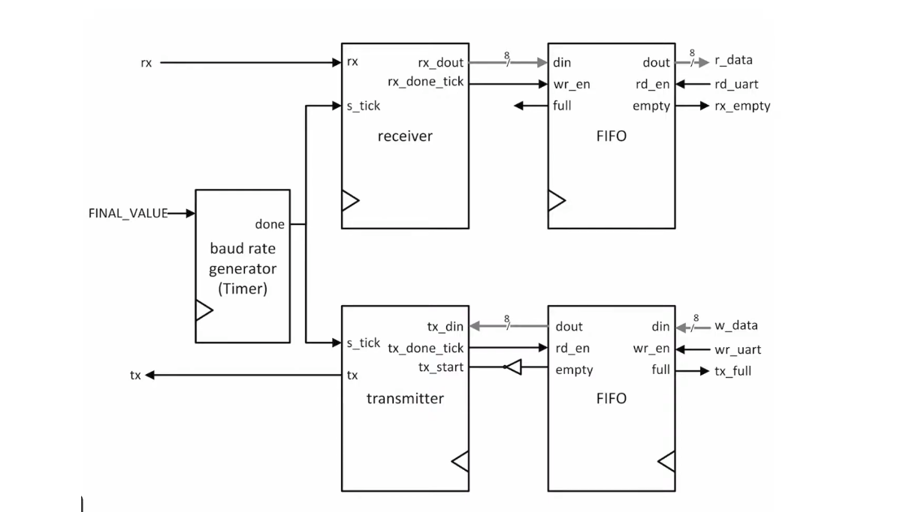
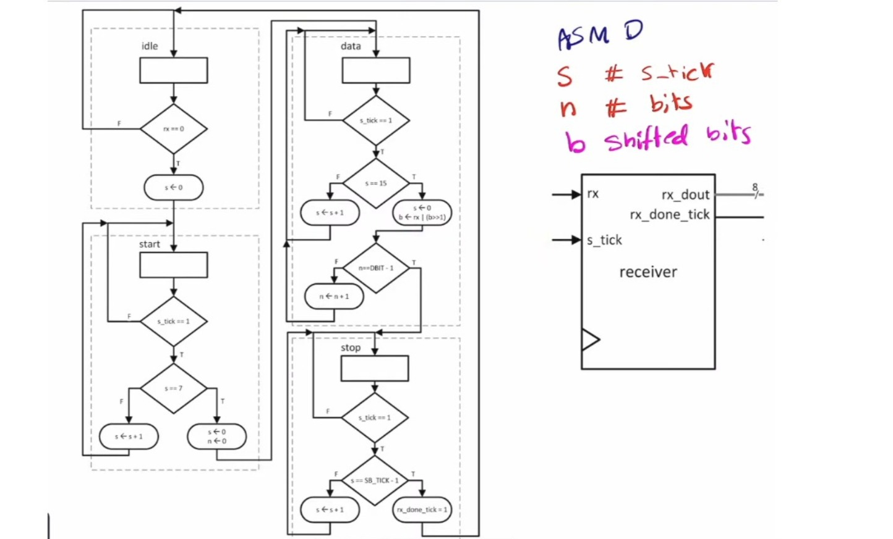
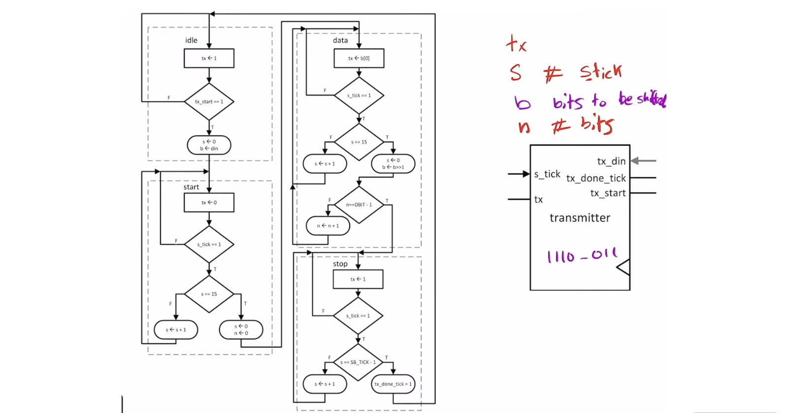

# Project UART

A UART (Universal Asynchronous Receiver/Transmitter) controller implemented in Verilog HDL using Vivado.


### UART Design



## Project Structure

```text
Project-UART/
├── rtl/
│   ├── UART.v
│   ├── timer_module.v
│   ├── uart_rx.v
│   └── uart_tx.v
└── README.md
```

## Modules

- **`UART.v`** — Top-level UART controller connecting the transmitter, receiver, timing logic, and FIFOs.
- **`uart_tx.v`** — UART transmitter.
- **`uart_rx.v`** — UART receiver.
- **`timer_module.v`** — Timing module used by the UART design.

## Dependencies

The design uses the Xilinx `fifo_generator_0` IP core, which must be configured in Vivado.

## UART RX FSM


## UART TX FSM




## Status

Work in progress.
